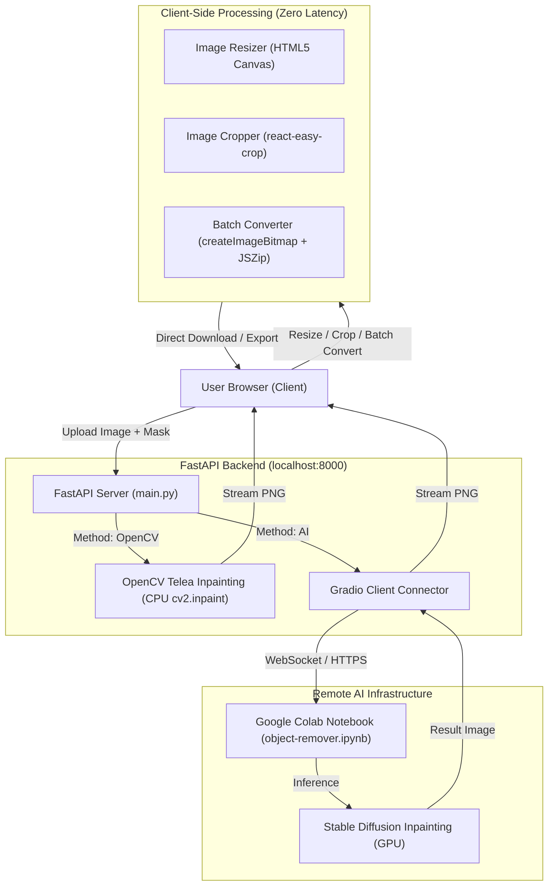

# Image Toolkit

[](https://nextjs.org/)
[](https://react.dev/)
[](https://www.typescriptlang.org/)
[](https://tailwindcss.com/)
[](https://fastapi.tiangolo.com/)
[](https://www.python.org/)
[](https://opencv.org/)
[](https://www.gradio.app/)
[](https://colab.research.google.com/)

> **A high-performance, hybrid image manipulation suite combining zero-latency browser-native processing with state-of-the-art Computer Vision and Generative AI inpainting.**

🔗 **Live Demo:** [https://image-toolkit-studio.vercel.app/](https://image-toolkit-studio.vercel.app/)  
📁 **Repository:** [https://github.com/SalmanFrs/image-toolkit](https://github.com/SalmanFrs/image-toolkit)

---

## 🌟 Overview

**Image Toolkit** is a full-stack image processing web application designed to bridge the gap between lightweight browser utility tools and heavy deep-learning workflows. Built with a **hybrid architecture**:

- **Client-Side Workflows**: Tools such as resizing, cropping, and batch conversion execute entirely in-browser using HTML5 Canvas and `createImageBitmap` APIs, providing instantaneous processing without uploading sensitive media to any server.
- **Server & AI Inpainting**: Complex object removal tasks are routed through a Python **FastAPI** backend that supports classical computer vision algorithms (**OpenCV Telea**) on local CPUs, or seamlessly delegates generative inpainting to **Stable Diffusion 1.5** hosted via **Gradio / Google Colab GPU instances**.

---

## 🚀 Key Features

### 1. 🪄 AI & Classical Object Remover

Remove unwanted elements, artifacts, or photo-bombers with an intuitive brush masking interface.

- **Interactive Mask Editor**: Precision brush control with adjustable radius, multi-step undo history, full canvas clear, and option to export raw binary masks.
- **Dual Processing Engines**:
  - **OpenCV Telea (Local CPU)**: Fast, server-side inpainting via fast marching method (`cv2.inpaint`), with custom inpainting radius and morphological mask dilation settings.
  - **Generative AI (Stable Diffusion 1.5)**: Deep-learning diffusion-based inpainting orchestrated through `gradio_client` connected to a remote Google Colab GPU notebook.
- **Interactive Visual Comparison**:
  - **Split-Screen Slider**: Smooth horizontal before/after slider to inspect inpainting boundaries.
  - **Side-by-Side Mode**: Synchronized parallel viewport comparison for detailed inspection.

### 2. 📐 Smart Image Resizer

High-fidelity client-side image scaling designed for speed and web optimization.

- **Custom Dimensions**: Scale up to 12,000 px with instant aspect-ratio locking or freeform dimensions.
- **Multi-Format Export**: Convert seamlessly across **PNG**, **JPG**, and **WebP** with auto-detection of the original uploaded format.
- **Quality & Compression Controls**: Granular compression quality slider for lossy formats (JPG/WebP) with white background fills to prevent transparent alpha clipping.
- **Real-Time Output Preview**: Inspect the resulting output image dimensions, visual sharpness, and calculated byte size before downloading.

### 3. ✂️ Interactive Image Cropper

Crop, reframe, and orient images with sub-pixel precision powered by `react-easy-crop`.

- **8 Aspect Ratio Presets**: Choose between **Original**, **1:1 (Square)**, **4:3**, **16:9 (Widescreen)**, **3:2**, **2:3 (Portrait)**, **3:4**, and **9:16 (Stories/Reels)**, or freeform cropping.
- **Transformation Tools**: Smooth zoom magnification and 90° clockwise/counter-clockwise hardware-accelerated canvas rotation.
- **Live Output Telemetry**: Live display of cropped pixel width/height and crop coordinate telemetry.
- **Preview & Format Export**: Dedicated full-resolution modal preview with output format selection (PNG/JPG/WebP).

### 4. 📦 Batch Format Converter

Convert and compress image collections in parallel entirely within the user's browser.

- **Multi-File Queue**: Drag and drop up to 20 images simultaneously (max 15 MB per file).
- **Client-Side Bulk Conversion**: Rapid parallel rasterization to PNG, JPG, or WebP with global compression quality tuning.
- **Storage Metrics**: Direct comparison showing original vs. converted byte sizes and percentage saved.
- **Flexible Downloads**: Download individual converted files or package the entire batch into a single `.ZIP` archive on the fly using `JSZip`.

---

## 🏗️ System Architecture



### Tech Stack Breakdown

| Layer               | Technologies                                                             | Role / Highlights                                                                        |
| :------------------ | :----------------------------------------------------------------------- | :--------------------------------------------------------------------------------------- |
| **Frontend**        | **Next.js 16 (App Router)**, **React 19**, **TypeScript**                | Responsive modern UI with server-rendered static shells and dynamic client-side tooling. |
| **Styling**         | **Tailwind CSS v4**, **Turbopack**                                       | Modern dark-themed design system, smooth micro-interactions, and responsive layouts.     |
| **Client Libs**     | **react-easy-crop**, **JSZip**                                           | Touch/mouse crop interaction and multi-file zip packaging.                               |
| **Backend**         | **Python 3.10+**, **FastAPI**, **Uvicorn**                               | Asynchronous REST API serving endpoints for classical CV and AI routing.                 |
| **Computer Vision** | **OpenCV (`opencv-python-headless`)**, **Pillow**, **NumPy**             | Binary mask thresholding, morphological dilation, and Telea Fast Marching inpainting.    |
| **AI Inference**    | **Stable Diffusion 1.5 Inpainting**, **Gradio Client**, **Google Colab** | Remote GPU pipeline for generative filling of complex masked areas.                      |

---

## 📂 Project Structure

```text
image-toolkit/
├── backend/
│   ├── .env.example            # Backend environment template (GRADIO_URL)
│   ├── main.py                 # FastAPI application, endpoints & CV logic
│   └── requirements.txt        # Python backend dependencies
├── frontend/
│   ├── app/
│   │   ├── components/
│   │   │   ├── BatchConverter.tsx  # Multi-file format converter & ZIP packager
│   │   │   ├── ImageCropper.tsx    # Crop & rotation tool using react-easy-crop
│   │   │   ├── ImageEditor.tsx     # Inpainting mask brush & comparison views
│   │   │   └── ImageResizer.tsx    # Image scaling & format compression
│   │   ├── globals.css         # Global styles & Tailwind configuration
│   │   ├── layout.tsx          # Root layout and metadata
│   │   └── page.tsx            # Main application tab switcher & state
│   ├── .env.example            # Frontend environment template (NEXT_PUBLIC_API_URL)
│   ├── package.json            # Node.js dependencies and scripts
│   ├── next.config.ts          # Next.js build configuration
│   └── tsconfig.json           # TypeScript configuration
├── notebooks/
│   └── object-remover.ipynb    # Google Colab notebook hosting the Gradio AI service
├── .gitignore
├── LICENSE
└── README.md
```

---

## 🛠️ Getting Started (Local Setup)

### Prerequisites

- **Node.js**: version 20+ (recommended 22+) and **npm**
- **Python**: version 3.10+
- **Google Colab Account** _(optional, only needed for the AI Inpainting mode)_

> **Note**: The **Image Resizer**, **Image Cropper**, and **Batch Format Converter** operate **100% client-side** in your browser. You can run and use these features without starting the Python backend.

---

### 1. Backend Setup (FastAPI)

1. Open a terminal and navigate to the `backend` directory:

   ```bash
   cd backend
   ```

2. Create and activate a Python virtual environment:
   - **Windows (PowerShell)**:
     ```powershell
     python -m venv .venv
     .\.venv\Scripts\Activate.ps1
     ```
   - **Linux / macOS**:
     ```bash
     python3 -m venv .venv
     source .venv/bin/activate
     ```

3. Install the dependencies:

   ```bash
   pip install -r requirements.txt
   ```

4. Create a `.env` file based on `.env.example`:

   ```bash
   cp .env.example .env
   ```

   _If you intend to run AI Inpainting, paste your active public Gradio URL into `GRADIO_URL`. For OpenCV-only testing, you can leave any placeholder or dummy URL in `.env`._

5. Start the FastAPI development server:
   ```bash
   uvicorn main:app --reload --port 8000
   ```
   The API will be available at `http://localhost:8000` (Health check: `http://localhost:8000/health`).

---

### 2. Frontend Setup (Next.js)

1. Open a second terminal and navigate to the `frontend` directory:

   ```bash
   cd frontend
   ```

2. _(Optional)_ Configure environment variables:
   By default, the frontend connects to `http://127.0.0.1:8000`. If your FastAPI backend runs on a different port or host, copy `.env.example` to `.env.local` and configure `NEXT_PUBLIC_API_URL`:

   ```bash
   cp .env.example .env.local
   ```

3. Install npm dependencies:

   ```bash
   npm install
   ```

4. Launch the development server:

   ```bash
   npm run dev
   ```

5. Open your browser and navigate to **[http://localhost:3000](http://localhost:3000)**.

---

### 3. Setting Up the AI Inpainting Backend (Google Colab)

To enable **Generative AI Inpainting** (Stable Diffusion 1.5):

1. Upload and open `notebooks/object-remover.ipynb` in [Google Colab](https://colab.research.google.com/).
2. Change the Colab runtime type to **T4 GPU** (`Runtime > Change runtime type > T4 GPU`).
3. Run all cells in the notebook. At the end, Gradio will generate a public live tunnel link (e.g., `https://xxxx.gradio.live`).
4. Copy this public URL and paste it into `backend/.env`:
   ```env
   GRADIO_URL="https://xxxx.gradio.live"
   ```
5. Restart your FastAPI backend server. The Object Remover tool will now use Stable Diffusion when the **AI Mode** toggle is selected.

---

## 🔮 Deployment & Future Roadmap

- **Frontend Deployment**: Can be deployed to **Vercel** or **Netlify** with zero additional configuration. When connecting to a deployed backend, add the `NEXT_PUBLIC_API_URL` environment variable pointing to your FastAPI service URL.
- **Backend Deployment**: The FastAPI application can be containerized with Docker and hosted on **Hugging Face Spaces (CPU)**, **Render**, or **Railway** for OpenCV processing.
- **Permanent AI Serving**: Transition the temporary Colab Gradio endpoint to a dedicated serverless GPU endpoint (such as **Modal**, **RunPod**, or **Replicate**) for 24/7 cloud inpainting availability.
- **Additional Roadmap Features**:
  - Web Worker support for off-thread multi-image batch conversion.
  - Smart automatic object segmentation using Segment Anything (SAM).
  - EXIF metadata viewing and stripping for privacy protection.

---

## 📄 License

This project is licensed under the [MIT License](LICENSE).
