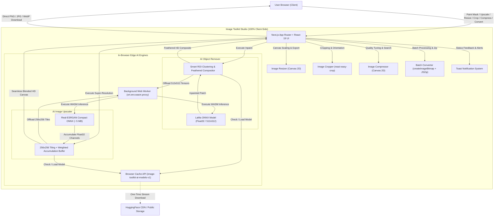

# Image Toolkit


> **A 100% private, client-side image manipulation and AI studio running entirely in your browser with zero backend requirements.**

🔗 **Live Demo:** [https://image-toolkit-studio.vercel.app/](https://image-toolkit-studio.vercel.app/)  
📁 **Repository:** [https://github.com/SalmanFrs/image-toolkit](https://github.com/SalmanFrs/image-toolkit)

---

## 🌟 Overview

**Image Toolkit** is a pure, zero-backend edge web application designed for fast, high-quality image editing, batch conversion, and in-browser deep learning.

- **100% Client-Side Privacy**: All processing runs locally inside the browser using HTML5 Canvas, WebAssembly (WASM), and modern web APIs. No photos or media files are ever transmitted to any external server.
- **In-Browser Deep Learning**: Eliminates cloud GPU servers by executing neural networks directly in the browser using `onnxruntime-web` with dedicated background Web Worker isolation.
- **Persistent Local AI Model Caching**: AI models are streamed once and stored locally in the browser's native Cache API (`image-toolkit-ai-models-v1`), enabling instant offline-ready execution on future visits with clear cache-status indicators.
- **Background Tab Continuity**: Execution uses timeout yielding instead of animation frames, ensuring long inference runs continue uninterrupted even when users switch browser tabs.
- **Unified UX & Telemetry**: Live progress bars with elapsed timers (`MM:SS`), interactive Before/After comparison sliders, compact model status badges, and non-intrusive toast notifications across every tool.
- **Consistent File Naming**: Processed images export cleanly matching the `{originalName}-{featureName}-result.{ext}` pattern.

---

## 🚀 Key Features

### 1. 🪄 AI Object Remover (LaMa Inpainting)

Remove unwanted objects, watermarks, text, or photo-bombers with an intelligent brush masking interface running entirely in your browser.

- **Interactive Selection Brush & Viewport Controls**: Adjustable brush size slider (5 px to 150 px), stroke counter, multi-step undo, clear selection, binary mask PNG export, and edge-snapping coordinates for clean border inpainting.
- **Canvas Zoom & Pan**: Precision zoom controls (100% to 400%), two-finger pinch-to-zoom on touchscreens, Move/Pan mode, and strict viewport clamping to inspect details without page scrolling interference.
- **Zeroed-Out Masked Pixels & Auto Dilation**: Automatically zeros RGB channels of masked pixels before tensor creation to prevent color bleeding, paired with 4px dilation and feathered compositing to eliminate outer glow or residual edges.
- **Connected-Component Clustering**: Employs 128x128 grid clustering (BFS) to isolate distant objects and process them sequentially without downsampling the whole image.
- **One-Time Download Confirmation Modal**: Prompts users with a custom dark modal before downloading the ~198 MB LaMa model on first use, skipping immediately on subsequent runs if cached.
- **Live Elapsed Timer & Result Duration**: Real-time progress bar with step tracker and live `MM:SS` timer, displaying a permanent completion badge (e.g. `Processed in 00:04`) on the result header.
- **Continue Editing Workflow**: Load the inpainting result directly back into the editor canvas with a single click to perform sequential brush passes without re-uploading.
- **Interactive Comparison Slider**: Draggable horizontal split slider to compare the original image and inpainted result seamlessly.

### 2. ✨ AI Image Upscaler (Super-Resolution)

Upscale and restore low-resolution photos and illustrations up to 400% using client-side AI Super-Resolution powered by Real-ESRGAN Compact.

- **2x and 4x Super-Resolution**: Upscale images cleanly to 2x or 4x their original resolution with enhanced details and clarity.
- **Dual Enhancement Styles**:
  - **Photo**: Preserves natural grain, skin tones, and organic textures with refined detail sharpening.
  - **Illustration**: Produces clean, crisp outlines for digital art, anime, logos, and graphic design.
- **Tiled Inference with Weighted Accumulation Buffer**: Slices images into 256x256 tiles with 16px overlap, accumulating into 4-channel Float32 buffers with linear boundary weights to eliminate dark grid seams and out-of-memory errors.
- **High-Dimension Progressive Fallback**: Automatically switches to multi-step progressive canvas scaling paired with unsharp mask sharpening for images exceeding 2048px.
- **One-Time Download Confirmation Modal**: Clean modal dialog confirming the one-time ~5 MB model download with instant subsequent loads from browser cache.
- **Live Progress & Stats Banner**: Displays real-time tile inference percentage, live elapsed timer (`MM:SS`), pixel gain indicator (`+100%` or `+300% Pixels`), and total elapsed time badge (`Time: MM:SS`).
- **Interactive Comparison Slider**: Full-width interactive split slider to evaluate clarity before downloading.

### 3. ⚡ Client-Side Image Compressor

Intelligent browser-based compression balancing aggressive file size reduction with visual quality.

- **High-Capacity File Support**: Supports files up to 30 MB (PNG, JPG, or WebP) directly on your device.
- **Dual Compression Modes**:
  - **Quality Slider & Presets**: Granular 10% to 100% control with one-click presets: High Quality (85%), Balanced (75%), and Maximum Compression (50%).
  - **Target File Size Search**: Automatic binary search iteration to achieve a target maximum file size in KB, with progressive dimension scaling fallback for lossless PNGs and high-resolution images.
- **Format Auto-Detection**: Retains or converts formats across JPG, WebP, and PNG with auto-detection on upload.
- **Optional Max Dimension Scaling**: Optional downscaling for additional byte savings (e.g. 1920px).
- **Interactive Comparison Slider**: Split slider to inspect visual quality before downloading.

### 4. 📐 Smart Image Resizer

High-fidelity image scaling designed for speed, flexibility, and web optimization.

- **Custom Dimensions**: Scale up to 12,000 px with instant aspect-ratio locking or freeform dimensions.
- **Multi-Format Export**: Convert seamlessly across **PNG**, **JPG**, and **WebP** with auto-detection of the uploaded format.
- **Quality & Compression Controls**: Compression quality slider for lossy formats (JPG/WebP) with clean background fills.
- **Real-Time Output Preview**: Inspect resulting output image dimensions, visual sharpness, and calculated byte size before downloading.

### 5. ✂️ Interactive Image Cropper

Crop, reframe, and orient images with sub-pixel precision powered by `react-easy-crop`.

- **8 Aspect Ratio Presets**: Choose between **Original**, **1:1 (Square)**, **4:3**, **16:9 (Widescreen)**, **3:2**, **2:3 (Portrait)**, **3:4**, and **9:16 (Stories/Reels)**, or freeform cropping.
- **Accidental Rotation Prevention**: Pinch gestures on mobile are strictly locked to zoom in/out, while canvas rotation is controlled via dedicated 90-degree clockwise and counter-clockwise buttons.
- **Bounded Canvas Clamping**: Clamps crop boundaries to prevent white background borders in export.
- **Live Dimension Telemetry**: Live display of cropped pixel width/height and crop coordinate telemetry.

### 6. 📦 Batch Format Converter

Convert and compress image collections in parallel entirely within your browser.

- **Multi-File Queue**: Drag and drop up to 20 images simultaneously (max 15 MB per file).
- **Parallel Bulk Conversion**: Fast parallel rasterization to PNG, JPG, or WebP with global compression quality tuning.
- **Storage Metrics**: Direct comparison showing original vs. converted byte sizes and percentage saved.
- **Flexible Downloads**: Download individual converted files or package the entire batch into a single archive (`image-toolkit-converted.zip`) on the fly using `JSZip`.

---

## 🏗️ System Architecture



---

## 💻 Tech Stack Breakdown

| Technology | Role & Highlights |
| :--- | :--- |
| **Next.js 16 (App Router)** | Modern React 19 framework providing optimized client hydration, partial prefetching, and clean modular component structure. |
| **TypeScript 5** | Strict type safety across image pipelines, accumulation buffers, and ONNX tensor interfaces. |
| **Tailwind CSS v4** | Dark-themed styling, micro-animations (shimmer, scanline), and mobile-responsive layout. |
| **ONNX Runtime Web (`onnxruntime-web`)** | WebAssembly execution provider running inside background Web Workers (`proxy = true`) for non-blocking AI inference. |
| **LaMa (Large Mask Inpainting)** | Fast Fourier convolution (FFC) model running client-side for structural object and blemish removal. |
| **Real-ESRGAN Compact** | Lightweight super-resolution model (~5 MB) delivering 2x and 4x upscaling directly in the browser. |
| **HTML5 Canvas 2D** | Hardware-accelerated image scaling, drawing, mask dilation, and feathered compositing. |
| **react-easy-crop** | High-performance touch and mouse cropping with customizable aspect ratios and rotation. |
| **JSZip** | In-browser client-side archive generation for batch image downloads. |
| **lucide-react** | Clean, lightweight UI icons for duration timers and status telemetry. |

---

## 📂 Project Structure

```text
image-toolkit/
├── app/
│   ├── components/
│   │   ├── BatchConverter.tsx   # Multi-file format converter & ZIP packager
│   │   ├── ImageCompressor.tsx  # Browser-based image compression & target size search
│   │   ├── ImageCropper.tsx     # Crop & rotation tool using react-easy-crop
│   │   ├── ImageEditor.tsx      # Inpainting mask brush, progress UI & comparison slider
│   │   ├── ImageResizer.tsx     # Image scaling & format compression
│   │   ├── ImageUpscaler.tsx    # Client-side AI super-resolution (Real-ESRGAN Compact)
│   │   └── Toast.tsx            # Zero-dependency toast notification viewport & hook
│   ├── lib/
│   │   ├── imageUpscaler.ts     # Super-resolution engine, tiled inference & accumulation buffer
│   │   └── lamaInpaint.ts       # LaMa ONNX engine, streaming Cache API & ROI compositor
│   ├── globals.css              # Global styles, shimmer & scanline keyframes
│   ├── icon.svg                 # Scalable high-res vector favicon
│   ├── layout.tsx               # Root layout and metadata
│   └── page.tsx                 # Studio navigation, tool switcher & guides
├── public/                      # Static assets, branding logo & vector icons
├── .env.example                 # Optional environment configuration
├── .gitignore                   # Git ignore rules for Next.js & node_modules
├── eslint.config.mjs            # ESLint configuration
├── LICENSE                      # MIT License
├── next.config.ts               # Next.js configuration
├── package.json                 # Node.js dependencies and scripts
├── README.md                    # Project documentation
└── tsconfig.json                # TypeScript compiler configuration
```

---

## 🛠️ Getting Started (Local Setup)

### Prerequisites

- **Node.js**: version 20+ (recommended 22+)
- **npm** (comes bundled with Node.js)

### Installation & Run

1. Clone the repository:
   ```bash
   git clone https://github.com/SalmanFrs/image-toolkit.git
   cd image-toolkit
   ```

2. Install dependencies:
   ```bash
   npm install
   ```

3. *(Optional)* Configure custom AI model URLs:
   Copy `.env.example` to `.env.local` if you wish to host the ONNX models on a custom CDN or self-hosted endpoint:
   ```bash
   cp .env.example .env.local
   ```

4. Start the development server:
   ```bash
   npm run dev
   ```

5. Open **[http://localhost:3000](http://localhost:3000)** in your browser.

---

## 🚀 Deployment

Because Image Toolkit is **100% client-side**, it can be deployed with zero backend infrastructure to any static hosting provider or modern edge platform:

- **Vercel**: Import the repository and deploy with default Next.js settings.
- **Netlify / Cloudflare Pages / GitHub Pages**: Deploy using standard Next.js build commands (`npm run build`).

---

## 📄 License

This project is licensed under the [MIT License](LICENSE).
