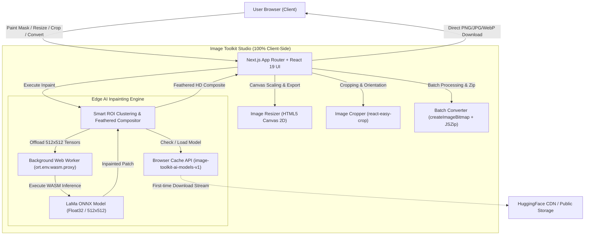

# Image Toolkit

[](https://nextjs.org/)
[](https://react.dev/)
[](https://www.typescriptlang.org/)
[](https://tailwindcss.com/)
[](https://onnxruntime.ai/)
[](https://webassembly.org/)
[](LICENSE)

> **A 100% private, client-side image manipulation and AI studio running entirely in your browser with zero backend requirements.**

🔗 **Live Demo:** [https://image-toolkit-studio.vercel.app/](https://image-toolkit-studio.vercel.app/)  
📁 **Repository:** [https://github.com/SalmanFrs/image-toolkit](https://github.com/SalmanFrs/image-toolkit)

---

## 🌟 Overview

**Image Toolkit** is a pure, zero-backend edge application for everyday image editing, format conversion, and state-of-the-art AI object removal. 

- **100% Client-Side Privacy**: All processing occurs locally within the user's browser via HTML5 Canvas, WebAssembly (WASM), and browser APIs. No photos or media files are ever uploaded to any external server.
- **In-Browser Deep Learning (LaMa ONNX)**: Eliminates the need for expensive Python servers or cloud GPU clusters by executing the Large Mask Inpainting (LaMa) model directly in the browser via `onnxruntime-web`.
- **Persistent Local AI Caching**: Models are streamed once and cached in the browser's native `Cache API`, enabling instantaneous offline-ready processing on subsequent uses.
- **High-Resolution Smart ROI Compositing**: Eliminates blurry upscaling by automatically isolating stroke clusters, running localized 512×512 inpainting on square ROIs, and blending seamless feathered patches back onto the full original HD canvas.

---

## 🚀 Key Features

### 1. 🪄 AI Object Remover (LaMa Inpainting)

Remove unwanted objects, watermarks, text, or photo-bombers with an intelligent brush masking interface running entirely in-browser.

- **Interactive Selection Brush**: Adjustable brush size slider (5 px – 150 px), stroke counter, multi-step undo, clear canvas, and binary mask PNG export.
- **Dedicated Background Web Worker**: Runs WASM inference in an isolated thread (`ort.env.wasm.proxy = true`) preventing UI freezes or browser "Page Unresponsive" warnings.
- **Multi-Region & Cluster Detection**: Employs downsampled 128×128 connected-component clustering (BFS). Distinct, distant markings (such as logos in opposite corners) are automatically isolated and sequentially inpainted without downsampling the whole image.
- **Smart ROI & Feathered Compositing**: Restricts inpainting to square padded patches around each mask cluster, applying a 2px feathered alpha mask so surrounding HD pixels remain 100% untouched.
- **Real-Time UX Telemetry**: Features real-time download progress with MB counter and completion percentage, a phase-based stepper (Download → Load AI → Prepare → Infer → Compose), and a pulsing scanline overlay.
- **Interactive Visual Comparison**:
  - **Split-Screen Slider**: Smooth horizontal before/after draggable divider to inspect boundaries.
  - **Side-by-Side Mode**: Synchronized viewports for side-by-side comparison.

### 2. 📐 Smart Image Resizer

High-fidelity client-side image scaling designed for speed and web optimization.

- **Custom Dimensions**: Scale up to 12,000 px with instant aspect-ratio locking or freeform dimensions.
- **Multi-Format Export**: Convert seamlessly across **PNG**, **JPG**, and **WebP** with auto-detection of the uploaded format.
- **Quality & Compression Controls**: Granular compression quality slider for lossy formats (JPG/WebP) with clean background fills.
- **Real-Time Output Preview**: Inspect resulting output image dimensions, visual sharpness, and calculated byte size before downloading.

### 3. ✂️ Interactive Image Cropper

Crop, reframe, and orient images with sub-pixel precision powered by `react-easy-crop`.

- **8 Aspect Ratio Presets**: Choose between **Original**, **1:1 (Square)**, **4:3**, **16:9 (Widescreen)**, **3:2**, **2:3 (Portrait)**, **3:4**, and **9:16 (Stories/Reels)**, or freeform cropping.
- **Transformation Tools**: Smooth zoom magnification and 90° clockwise/counter-clockwise hardware-accelerated canvas rotation.
- **Live Output Telemetry**: Live display of cropped pixel width/height and crop coordinate telemetry.
- **Preview & Format Export**: Dedicated full-resolution preview with output format selection (PNG/JPG/WebP).

### 4. 📦 Batch Format Converter

Convert and compress image collections in parallel entirely within the user's browser.

- **Multi-File Queue**: Drag and drop up to 20 images simultaneously (max 15 MB per file).
- **Client-Side Bulk Conversion**: Rapid parallel rasterization to PNG, JPG, or WebP with global compression quality tuning.
- **Storage Metrics**: Direct comparison showing original vs. converted byte sizes and percentage saved.
- **Flexible Downloads**: Download individual converted files or package the entire batch into a single `.ZIP` archive on the fly using `JSZip`.

---

## 🏗️ System Architecture



---

## 💻 Tech Stack Breakdown

| Technology | Role & Highlights |
| :--- | :--- |
| **Next.js 16 (App Router)** | React 19 framework providing optimized client-side hydration, fast routing, and clean component architecture. |
| **TypeScript 5** | Strict type safety across image pipelines, bounding box geometry, and ONNX tensor interfaces. |
| **Tailwind CSS v4** | Dark-themed styling, micro-animations (shimmer, scanline), and mobile-responsive layout. |
| **ONNX Runtime Web (`onnxruntime-web`)** | WebAssembly execution provider with background worker proxy for client-side deep learning inference. |
| **LaMa (Large Mask Inpainting)** | State-of-the-art fast Fourier convolution (FFC) architecture for resolution-independent structural inpainting. |
| **HTML5 Canvas 2D** | Hardware-accelerated image scaling, drawing, mask dilation, and feathered compositing. |
| **react-easy-crop** | High-performance touch and mouse cropping with customizable aspect ratios and rotation. |
| **JSZip** | In-browser client-side archive generation for batch image downloads. |

---

## 📂 Project Structure

```text
image-toolkit/
├── app/
│   ├── components/
│   │   ├── BatchConverter.tsx   # Multi-file format converter & ZIP packager
│   │   ├── ImageCropper.tsx     # Crop & rotation tool using react-easy-crop
│   │   ├── ImageEditor.tsx      # Inpainting mask brush, progress UI & comparison views
│   │   └── ImageResizer.tsx     # Image scaling & format compression
│   ├── lib/
│   │   └── lamaInpaint.ts       # ONNX Runtime Web engine, streaming Cache API & ROI compositor
│   ├── favicon.ico
│   ├── globals.css              # Global styles, shimmer & scanline keyframes
│   ├── layout.tsx               # Root layout and metadata
│   └── page.tsx                 # Studio navigation & tool state
├── public/                      # Static assets and icons
├── .env.example                 # Optional environment configuration
├── .gitignore                   # Git ignore rules for Next.js & node_modules
├── eslint.config.mjs            # ESLint configuration
├── LICENSE                      # MIT License
├── next.config.ts               # Next.js configuration
├── package.json                 # Node.js dependencies and scripts
├── README.md                    # Project documentation
└── tsconfig.json                # TypeScript compiler configuration
```

---

## 🛠️ Getting Started (Local Setup)

### Prerequisites

- **Node.js**: version 20+ (recommended 22+)
- **npm** (comes with Node.js)

### Installation & Run

1. Clone the repository:
   ```bash
   git clone https://github.com/SalmanFrs/image-toolkit.git
   cd image-toolkit
   ```

2. Install dependencies:
   ```bash
   npm install
   ```

3. *(Optional)* Configure a custom LaMa model URL:
   Copy `.env.example` to `.env.local` if you wish to host the ONNX model on a custom CDN or self-hosted endpoint:
   ```bash
   cp .env.example .env.local
   ```

4. Start the development server:
   ```bash
   npm run dev
   ```

5. Open **[http://localhost:3000](http://localhost:3000)** in your browser.

---

## 🚀 Deployment

Because Image Toolkit is **100% client-side**, it can be deployed with zero backend infrastructure to any static hosting provider or modern edge platform:

- **Vercel**: Import the repository and deploy with default Next.js settings.
- **Netlify / Cloudflare Pages / GitHub Pages**: Deploy using standard Next.js build commands (`npm run build`).

---

## 📄 License

This project is licensed under the [MIT License](LICENSE).
